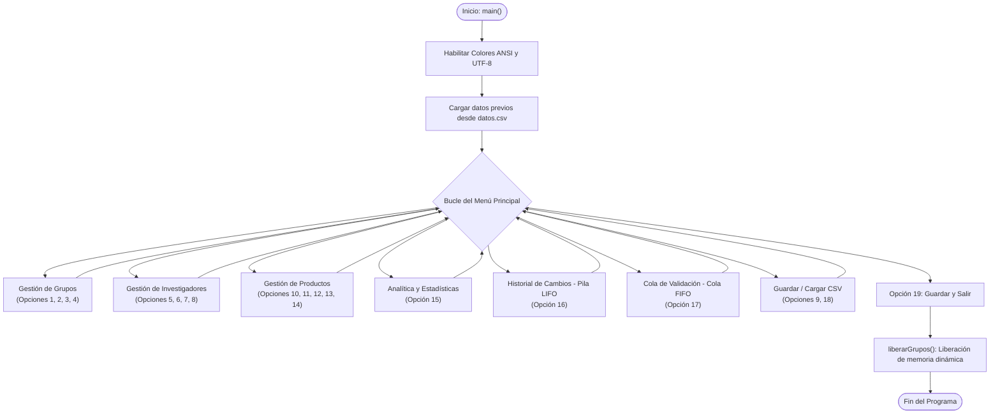
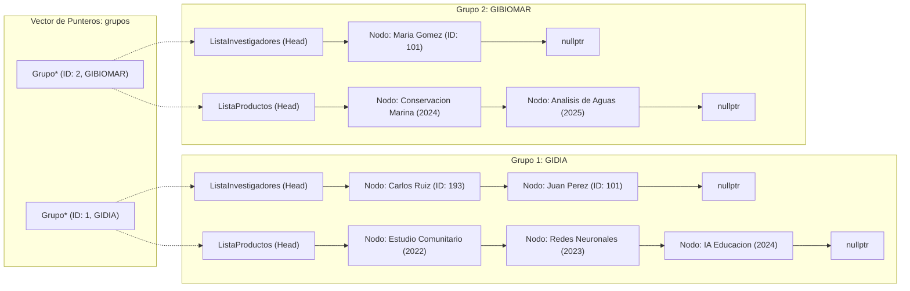
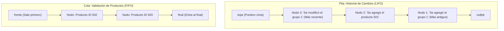

# Manual de Usuario — PEA-i (Versión Consola en C++)

> **Universidad Popular del Cesar (UPC)**  
> **Facultad de Ingenierías y Tecnológicas — Ingeniería de Sistemas**  
> **Asignatura:** Estructura de Datos (Grupo 05)  
> **Taller 2 — Segundo Corte**

---

## 1. Requisitos del Sistema

- **Sistema Operativo:** Windows 10/11, Linux o macOS.
- **Opción rápida sin instalar nada:** Puedes ejecutar directamente el binario compilado `programa.exe` incluido en la carpeta `cpp/` sin necesidad de instalar compiladores ni herramientas adicionales.
- **Para compilar desde el código fuente:**
  - Compilador con soporte para **C++17** o superior (`g++` / MinGW, `clang++` o MSVC).
  - Solo se utiliza la biblioteca estándar de C++ (`<iostream>`, `<string>`, `<vector>`, `<iomanip>`, `<fstream>`, etc.) y la API nativa de Windows (`<windows.h>`) para terminal ANSI. **No requiere librerías externas ni bases de datos SQL.**

---

## 2. Cómo Compilar y Ejecutar

Elige la alternativa que prefieras:

### Opción A: Ejecutar el binario compilado (Inmediato)
Abre PowerShell o Símbolo del Sistema (CMD) en la carpeta del proyecto y ejecuta:

```powershell
# Estando dentro de la carpeta cpp/
cd cpp
.\programa.exe

# O desde la raíz del repositorio
.\cpp\programa.exe
```

### Opción B: Compilar desde el código fuente con g++
Si deseas recompilar el ejecutable tras realizar modificaciones:

```bash
# Desde la raíz del repositorio
g++ -std=c++17 -Wall -Wextra -I cpp cpp/main.cpp -o cpp/programa.exe

# Ejecutar el nuevo binario
.\cpp\programa.exe
```

### Opción C: Desde Visual Studio Code
1. Abre la carpeta del proyecto en VS Code.
2. Abre la terminal integrada con ``Ctrl + ` ``.
3. Compila o ejecuta con `.\cpp\programa.exe`.

> [!TIP]
> **Colores ANSI y Caracteres en Windows:**
> El programa configura automáticamente `SetConsoleOutputCP(CP_UTF8)` y `ENABLE_VIRTUAL_TERMINAL_PROCESSING` para mostrar títulos en arte ASCII, tablas alineadas y colores de advertencia/éxito en la consola.

---

## 3. Arquitectura del Sistema (Diagramas Mermaid)

### 3.1. Flujo General del Menú y Navegación
El siguiente diagrama ilustra el flujo de control del programa y sus 19 opciones operativas:



---

### 3.2. Modelo de la Multilista en Memoria
El sistema almacena la información mediante una **Multilista jerárquica** construida a mano con nodos y punteros simples:



---

### 3.3. Estructuras Lineales: Pila (LIFO) y Cola (FIFO)



---

## 4. ¿Qué hace la aplicación? (Uso Breve)

El sistema presenta un menú interactivo en consola con **19 opciones numéricas** organizadas por módulos funcionales:

```text
==============================================
                  MENU                        
==============================================
 1) Agregar grupo         10) Agregar producto
 2) Eliminar grupo        11) Eliminar producto
 3) Modificar grupo       12) Modificar producto
 4) Mostrar grupos        13) Mostrar productos
 5) Agregar investigador  14) Filtrar productos por anio
 6) Eliminar investigador 15) Estadisticas
 7) Modificar investigador 16) Ver historial
 8) Mostrar investigadores 17) Cola de validacion
 9) Guardar datos         18) Cargar datos
                          19) Salir
==============================================
```

### 🏛 Módulo de Grupos (Opciones 1 a 4)
- **1) Agregar grupo:** Solicita ID numérico único, nombre del grupo y plan de trabajo. Registra el grupo en la multilista y apila la acción en el historial.
- **2) Eliminar grupo:** Solicita el ID del grupo, libera la memoria de sus integrantes y productos asociados, y lo retira del sistema.
- **3) Modificar grupo:** Permite actualizar el nombre y el plan de trabajo de un grupo existente.
- **4) Mostrar grupos:** Imprime el listado detallado de todos los grupos registrados junto con el resumen de sus miembros y productos.

### 👤 Módulo de Investigadores (Opciones 5 a 8)
- **5) Agregar investigador:** Solicita a qué grupo pertenecerá (por ID de grupo), ID único del investigador, nombre completo, área de conocimiento y categoría (Emérito, Senior, Asociado, Junior).
- **6) Eliminar investigador:** Quita un investigador de un grupo específico mediante su ID.
- **7) Modificar investigador:** Actualiza nombre, área o categoría del investigador seleccionado.
- **8) Mostrar investigadores:** Lista todos los investigadores vinculados a los grupos de investigación.

### 📄 Módulo de Productos (Opciones 10 a 14)
- **10) Agregar producto:** Asocia un producto al grupo seleccionado. Pide ID, título, año de publicación, categoría MinCiencias y estado de validación inicial (`si` / `no`). Si el producto no está validado, se encola automáticamente en la **Cola de Validación**.
- **11) Eliminar producto:** Remueve un producto del grupo por su ID.
- **12) Modificar producto:** Actualiza título, año, categoría o estado de validación de un producto.
- **13) Mostrar productos:** Lista todos los productos registrados indicando su pertenencia grupal y estado de validación.
- **14) Filtrar productos por año:** Filtro dinámico que permite consultar:
  - Productos de los últimos **2 años**.
  - Productos de los últimos **5 años**.
  - Productos dentro de un rango personalizado `[año_inicio - año_fin]`.

### 📊 Módulo de Estadísticas y Analítica (Opción 15)
Presenta una tabla consolidada utilizando formato alineado (`std::setw` de `<iomanip>`):
- Cantidad total de grupos registrados.
- Total de investigadores activos.
- Total de productos académicos registrados y porcentaje de productos validados.
- Promedio de productos por grupo.
- Conteo discriminado por categoría académica.

### 🔄 Módulo de Estructuras Especiales (Opciones 16 y 17)
- **16) Ver historial (Pila - LIFO):** Muestra cronológicamente todas las operaciones realizadas (creaciones, modificaciones y eliminaciones) desde la más reciente hasta la más antigua, recorriendo los nodos de la pila desde el `tope`.
- **17) Cola de validación (Cola - FIFO):** Revisa secuencialmente los productos pendientes de validación en estricto orden de llegada (`desencolar`), permitiendo al usuario aprobarlos o rechazarlos uno por uno.

### 💾 Persistencia y Salida (Opciones 9, 18 y 19)
- **9) Guardar datos:** Exporta el estado completo de la multilista al archivo plano `datos.csv`.
- **18) Cargar datos:** Lee `datos.csv` y reconstruye toda la jerarquía en memoria.
- **19) Salir:** Pregunta si se desean guardar los cambios pendientes, libera toda la memoria dinámica (`delete`) para evitar memory leaks y finaliza la aplicación.

---

## 5. Estructuras de Datos Utilizadas (Requisitos del Proyecto)

Todas las estructuras de datos fueron implementadas **a mano** mediante punteros y memoria dinámica en el heap:

| Estructura | Archivo | ¿Dónde y cómo se usa en el programa? |
| :--- | :--- | :--- |
| **Lista Enlazada Simple (Template)** | `estructuras.hpp` | Clase genérica `ListaEnlazada<T>` con puntero `cabeza` y métodos `insertar()`, `eliminar()`, `buscar()` y `mostrar()`. Se especializa como `ListaInvestigadores` y `ListaProductos`. |
| **Multilista Jerárquica** | `grupos.hpp` | Estructura `Grupo` que combina por composición una `ListaInvestigadores` y una `ListaProductos`, gestionada mediante punteros dinámicos (`Grupo*`) en `main.cpp`. |
| **Pila (Stack — LIFO)** | `grupos.hpp` | Clase `Pila` con puntero `tope`. Apila descripciones de eventos con `insertar()` y permite auditar el historial de acciones en orden inverso. |
| **Cola (Queue — FIFO)** | `grupos.hpp` | Clase `Cola` con punteros `frente` y `final`. Encola productos no validados con `insertar()` y los atiende en orden de llegada con `eliminar()`. |

---

## 6. Formato del Archivo de Persistencia (`datos.csv`)

El archivo `datos.csv` almacena la jerarquía completa en formato de texto plano con registros tipificados:

```csv
GRUPO,1,GIDIA,Desarrollo de software
INVESTIGADOR,1,193,Carlos Ruiz,Sociales,Asociado
INVESTIGADOR,1,101,Juan Perez,Ingeniería de Sistemas,Emerito
PRODUCTO,1,504,Estudio Comunitario,2022,Articulo B,1
PRODUCTO,1,503,Redes Neuronales,2023,Ponencia,1
PRODUCTO,1,501,IA en la Educación Avanzada,2024,Artículo A1,1
GRUPO,2,GIBIOMAR,Conservación costera
INVESTIGADOR,2,101,Maria Gomez,Biología Marina,Junior
PRODUCTO,2,505,Conservacion Marina,2024,Libro,1
PRODUCTO,2,502,Analisis de Aguas,2025,Libro,0
```

- Cada línea inicia con el tipo de entidad (`GRUPO`, `INVESTIGADOR`, `PRODUCTO`).
- Los investigadores y productos incluyen en su segunda columna el **ID del grupo** al cual pertenecen, permitiendo reconstruir con precisión la multilista en memoria.

---

## 7. Solución de Problemas Frecuentes

| Problema | Causa | Solución |
| :--- | :--- | :--- |
| En Windows CMD los acentos o caracteres del banner se ven extraños | La consola no tiene activa la página de códigos UTF-8. | Ejecuta `chcp 65001` en la consola antes de iniciar `programa.exe`. |
| Windows Defender o el antivirus bloquea `programa.exe` | Falso positivo típico en ejecutables compilados localmente con MinGW/g++. | Agrega una exclusión a la carpeta del proyecto o compila directamente con `g++`. |
| Error al compilar: `'g++' no se reconoce como un comando interno o externo` | El compilador MinGW / GCC no está agregado a la variable de entorno `PATH`. | Usa el ejecutable ya compilado `.\cpp\programa.exe` o instala MinGW-w64. |
| El programa no guarda los cambios | No se seleccionó la opción `9) Guardar datos` ni se confirmó al salir (`opción 19`). | Selecciona la opción 9 antes de cerrar o responde `s` al salir. |

---

## 8. Autores

Proyecto desarrollado para la asignatura **Estructura de Datos (Grupo 05)** — **Universidad Popular del Cesar (UPC)**:

- **Esteban Raúl Vergara Jaime** — CC: 1065595117 — `ervergara@unicesar.edu.co`
- **Luis Eduardo Gomes Rosales** — CC: 1118821800 — `luiseduardogomez@unicesar.edu.co`
