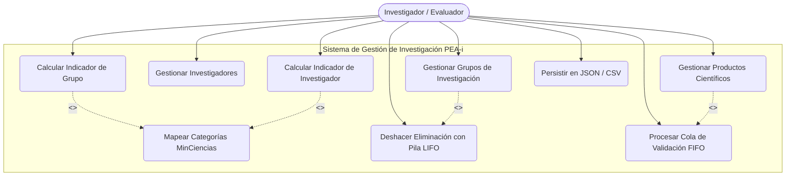
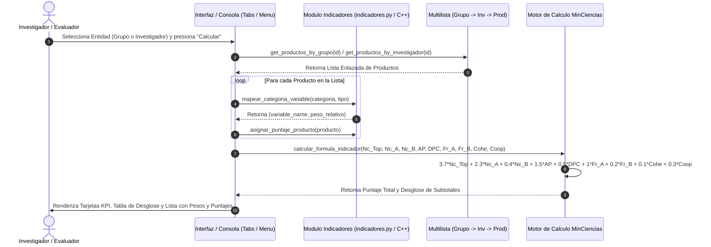

# Especificación de Requisitos de Software (SRS) — IEEE 830
## Proyecto PEA-i: Plataforma para la Evaluación y Analítica de la Investigación

**Asignatura:** Estructura de Datos (Grupo 05)  
**Institución:** Universidad Popular del Cesar (UPC), Valledupar, Colombia  
**Facultad:** Facultad de Ingenierías y Tecnologías  
**Programa:** Ingeniería de Sistemas  
**Evaluación:** Parcial 2 — Segundo Corte  
**Fecha:** Octubre de 2026  

---

### Autores e Integrantes del Proyecto
- **Esteban Raúl Vergara Jaime** — C.C. 1065595117 — `ervergara@unicesar.edu.co`
- **Luis Eduardo Gómez Rosales** — C.C. 1118821800 — `luiseduardogomez@unicesar.edu.co`

---

## 1. Introducción

### 1.1 Propósito
El presente documento describe la Especificación de Requisitos de Software (SRS) para el sistema **PEA-i (Plataforma para la Evaluación y Analítica de la Investigación)**, de acuerdo con las directrices del estándar **IEEE 830-1998**. El propósito es definir de manera rigurosa, no ambigua y verificable las funcionalidades, restricciones de diseño, estructuras de datos enlazadas y componentes de cálculo métrico correspondientes al segundo corte académico.

### 1.2 Alcance del Sistema
PEA-i es un ecosistema de software dual desarrollado en **Python** (con interfaz gráfica moderna bajo CustomTkinter y arquitectura de multilista jerárquica) y **C++** (implementación de alto rendimiento con punteros explícitos, manejo de memoria dinámica y estructuras lineales enlazadas). 

El sistema gestiona la información de Grupos de Investigación, Investigadores y Productos Científicos, incorporando:
1. Una **Multilista jerárquica** (Grupo $\rightarrow$ Investigadores $\rightarrow$ Productos).
2. Una **Pila (LIFO)** para historial de cambios y mecanismo de deshacer (Undo).
3. Una **Cola (FIFO)** para la atención y validación secuencial de productos.
4. Un motor de cálculo del **Indicador de Producción Científica** basado en el modelo oficial de MinCiencias Colombia.
5. Persistencia estructurada en formato **JSON** (Python) y **CSV** (C++).

### 1.3 Personal Involucrado
| Rol | Nombre | Identificación | Contacto |
| :--- | :--- | :--- | :--- |
| Desarrollador / Investigador 1 | Esteban Raúl Vergara Jaime | C.C. 1065595117 | `ervergara@unicesar.edu.co` |
| Desarrollador / Investigador 2 | Luis Eduardo Gómez Rosales | C.C. 1118821800 | `luiseduardogomez@unicesar.edu.co` |
| Docente Evaluador | Docente Titular Estructura de Datos | — | Universidad Popular del Cesar |

### 1.4 Definiciones, Acrónimos y Abreviaturas
- **IEEE:** Institute of Electrical and Electronics Engineers.
- **SRS / ERS:** Software Requirements Specification / Especificación de Requisitos de Software.
- **MinCiencias:** Ministerio de Ciencia, Tecnología e Innovación de Colombia.
- **Scienti / GrupLAC:** Plataformas nacionales de registro de grupos e investigadores científicos.
- **GNC:** Generación de Nuevo Conocimiento.
- **DTI:** Desarrollo Tecnológico e Innovación.
- **ASC:** Apropiación Social del Conocimiento y Divulgación Pública de la CTeI.
- **FRH:** Formación de Recurso Humano para la CTeI.
- **LIFO:** Last In, First Out (Último en entrar, primero en salir - Pila).
- **FIFO:** First In, First Out (Primero en entrar, primero en salir - Cola).
- **Multilista:** Estructura de datos no lineal compuesta por listas principales enlazadas a sublistas dependientes.

### 1.5 Referencias
1. IEEE Std 830-1998, *IEEE Recommended Practice for Software Requirements Specifications*.
2. MinCiencias Colombia (2024). *Modelo de Medición de Grupos de Investigación, Desarrollo Tecnológico o de Innovación y de Reconocimiento de Investigadores del Sistema Nacional de Ciencia, Tecnología e Innovación*.
3. Guía de Cátedra y Rúbrica del Parcial de Estructura de Datos (2do Corte), UPC.

---

## 2. Descripción General

### 2.1 Perspectiva del Producto
PEA-i es un software de escritorio autónomo, autocontenido y multiplataforma. No depende de sistemas gestores de bases de datos relacionales externos (SGBD) pesados; toda la lógica opera sobre memoria dinámica mediante nodos enlazados construidos desde cero por los estudiantes, garantizando el aprendizaje riguroso de las estructuras de datos fundamentales.

### 2.2 Funciones Principales del Producto
- **Gestión Jerárquica Multilista:** Creación, consulta, modificación y baja lógica de grupos, investigadores y productos.
- **Historial Reversible (Pila):** Registro de operaciones críticas de eliminación para su reversión ordenada.
- **Flujo de Validación (Cola):** Cola de inspección para productos sin validar, permitiendo su aprobación en orden de llegada.
- **Cálculo de Indicador de Producción Científica:** Ejecución de la fórmula paramétrica ponderada:
  $$\text{Indicador} = 3.7 \cdot Nc\_Top + 2.3 \cdot Nc\_A + 0.4 \cdot Nc\_B + 1.5 \cdot AP + 0.5 \cdot DPC + 1.0 \cdot Fr\_A + 0.2 \cdot Fr\_B + 0.1 \cdot Cohe + 0.3 \cdot Coop$$
- **Visualización en GUI y Consola:** Pestaña interactiva con KPIs dinámicos en Python y menú de consola alineado en C++.

### 2.3 Clases de Usuarios y Características
- **Líder de Investigación / Administrador:** Registra y audita la producción científica, evalúa puntajes para convocatorias de categorización.
- **Investigador Docente:** Consulta su portafolio de productos, revisa el peso relativo asignado y el puntaje individual obtenido.
- **Evaluador Académico:** Verifica la consistencia de las estructuras de datos, el correcto uso de punteros y la exactitud matemática de las fórmulas.

### 2.4 Entorno Operativo
- **Sistema Operativo:** Microsoft Windows 10/11 (x64) o distribuciones Linux compatibles.
- **Entorno Python:** Python 3.10 o superior, CustomTkinter, Pillow, Matplotlib, Pandas.
- **Entorno C++:** Compilador compatible con estándar ISO C++17 (GCC/MinGW, Clang, MSVC).

### 2.5 Restricciones de Implementación
- Se prohíbe el uso de contenedores automáticos (`std::vector`, `std::list`, `list` nativo) para sustituir las estructuras enlazadas evaluadas (Multilista, Pila de nodos, Cola de nodos).
- Los comentarios en código deben redactarse en español y los identificadores técnicos en inglés o estándar técnico.
- Codificación estricta en UTF-8 sin BOM.
- Totalmente local, sin dependencia de Git en el empaquetado final.

---

## 3. Requisitos Específicos

### 3.1 Requisitos Funcionales (RF)

#### RF-01: Estructura de Multilista Dinámica
- **Descripción:** El sistema debe estructurar los datos en memoria mediante una multilista donde cada nodo `Grupo` contiene un puntero `next` y un puntero `sublist` a la lista de `Investigadores`. A su vez, cada `Investigador` contiene un puntero a su sublista de `Productos`.
- **Entrada:** Datos de grupos, investigadores y productos.
- **Salida:** Grafo jerárquico navegable sin redundancia de memoria.

#### RF-02: Campos de Peso Relativo y Puntaje en Producto
- **Descripción:** Cada entidad `Producto` debe poseer los atributos flotantes `peso_relativo` (peso asignado según la taxonomía de la fórmula) y `puntaje` (calificación neta considerando el estado de validación).
- **Entrada:** Modificación o creación de producto.
- **Salida:** Producto con atributos actualizados y serializados en JSON/CSV.

#### RF-03: Mapeo de Categorías MinCiencias a Variables
- **Descripción:** El sistema debe clasificar automáticamente los productos según su categoría y tipo en las 7 variables de producto de la fórmula:
  - Artículos A1 / Top $\rightarrow$ $Nc\_Top$ (peso 3.7)
  - Artículos A2 / A $\rightarrow$ $Nc\_A$ (peso 2.3)
  - Artículos B $\rightarrow$ $Nc\_B$ (peso 0.4)
  - Artículos C / Apropiación Social $\rightarrow$ $AP$ (peso 1.5)
  - Divulgación Pública / Desarrollo Tecnológico $\rightarrow$ $DPC$ (peso 0.5)
  - Formación Posgrado (Doctorado/Maestría) $\rightarrow$ $Fr\_A$ (peso 1.0)
  - Formación Pregrado $\rightarrow$ $Fr\_B$ (peso 0.2)
- **Salida:** Coeficiente y variable asignada.

#### RF-04: Cálculo de Indicador de Grupo e Investigador
- **Descripción:** El sistema debe implementar la fórmula completa:
  $$\text{Indicador} = 3.7 \cdot Nc\_Top + 2.3 \cdot Nc\_A + 0.4 \cdot Nc\_B + 1.5 \cdot AP + 0.5 \cdot DPC + 1 \cdot Fr\_A + 0.2 \cdot Fr\_B + 0.1 \cdot Cohe + 0.3 \cdot Coop$$
- **Entrada:** ID de Grupo o Investigador seleccionado.
- **Salida:** Reporte con el valor final del indicador, cantidad de productos validados, y desglose variable por variable.

#### RF-05: Pestaña Interactiva en Interfaz Gráfica (Python)
- **Descripción:** La GUI debe proporcionar una pestaña dedicada "Indicador de Producción Científica" accesible desde la barra lateral.
- **Características:**
  - Selector conmutador entre "Grupo" e "Investigador".
  - ComboBox filtrable con las entidades cargadas en memoria.
  - 4 Tarjetas KPI (Indicador Total, Total Productos, Productos Top/A, Entidad Evaluada).
  - Tabla de desglose de la fórmula con coeficientes, conteos y subtotales.
  - Tabla detallada de productos evaluados indicando título, categoría, peso relativo y puntaje.

#### RF-06: Opción de Menú y Desglose en Consola (C++)
- **Descripción:** El programa en C++ debe incluir en su menú principal la opción `19) Calcular indicador (Parcial 2)`, permitiendo evaluar grupos individuales, investigadores específicos y generar la comparativa global de grupos.
- **Salida:** Tablas alineadas con `std::setw` e indicadores ANSI en color.

#### RF-07: Pila de Deshacer (Undo LIFO)
- **Descripción:** Toda eliminación de grupo, investigador o producto debe apilarse en una estructura `Pila` propia con nodos enlazados, permitiendo revertir la eliminación con `Ctrl+Z` o desde el botón de la interfaz.

#### RF-08: Cola de Validación (Cola FIFO)
- **Descripción:** Los productos marcados como "No validados" deben encolarse en una estructura `Cola` propia con nodos enlazados para su revisión ordenada secuencial.

#### RF-09: Persistencia Dual Compatible
- **Descripción:** Sincronización transparente de datos en `Parcial_2/python/datos/datos.json` y `Parcial_2/cpp/datos.csv`, soportando los nuevos campos `peso_relativo` y `puntaje`.

---

### 3.2 Requisitos No Funcionales (RNF)

| Código | Categoría | Descripción |
| :--- | :--- | :--- |
| **RNF-01** | **Rendimiento** | La inserción en listas enlazadas debe ejecutarse en tiempo $O(1)$ en cabeza. El cálculo de indicadores debe completarse en menos de 50 ms para 1.000 productos. |
| **RNF-02** | **Memoria** | Liberación explícita de nodos en destructores de C++ para garantizar cero fugas de memoria (*zero memory leaks*). |
| **RNF-03** | **Usabilidad** | Diseño UI institucional Unicesar (paleta azul slate, tipografía legible, controles de altura ergonómica). |
| **RNF-04** | **Robustez** | La consola C++ y la GUI Python deben ser inmunes a caídas por ingreso de tipos de datos incorrectos (*fail-safe input*). |
| **RNF-05** | **Portabilidad** | Cero dependencias de rutas fijas absolutas en el código; resolución dinámica mediante `Path(__file__)`. |

---

## 4. Diagramas UML

### 4.1 Diagrama de Casos de Uso (UML Use Case)

---

### 4.2 Diagrama de Secuencia: "Calcular Indicador de Producción Científica"

---

*Documento técnico elaborado y validado para la entrega del Parcial 2 — Estructura de Datos (UPC).*
